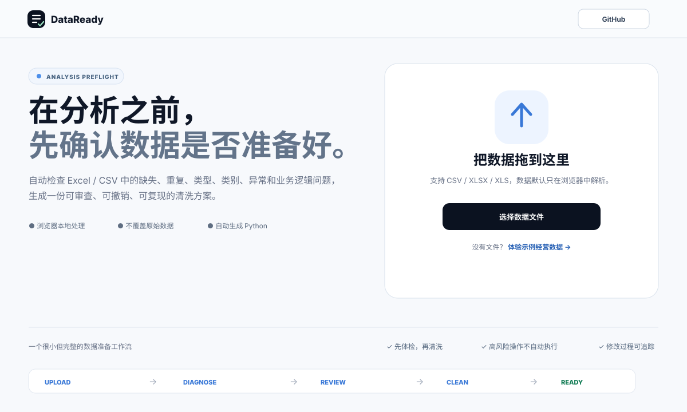
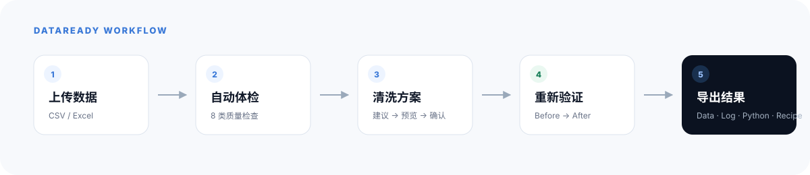
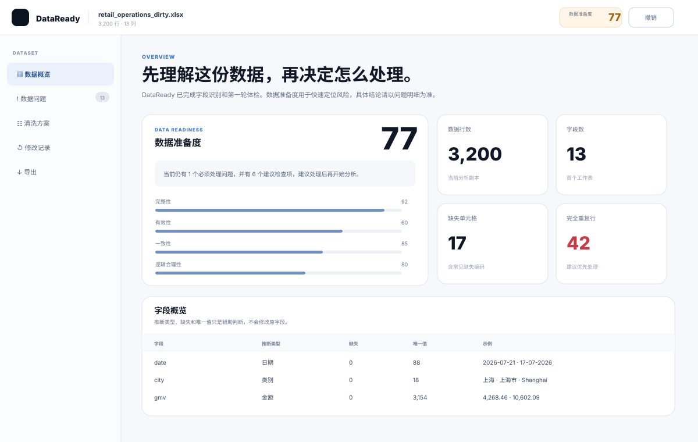
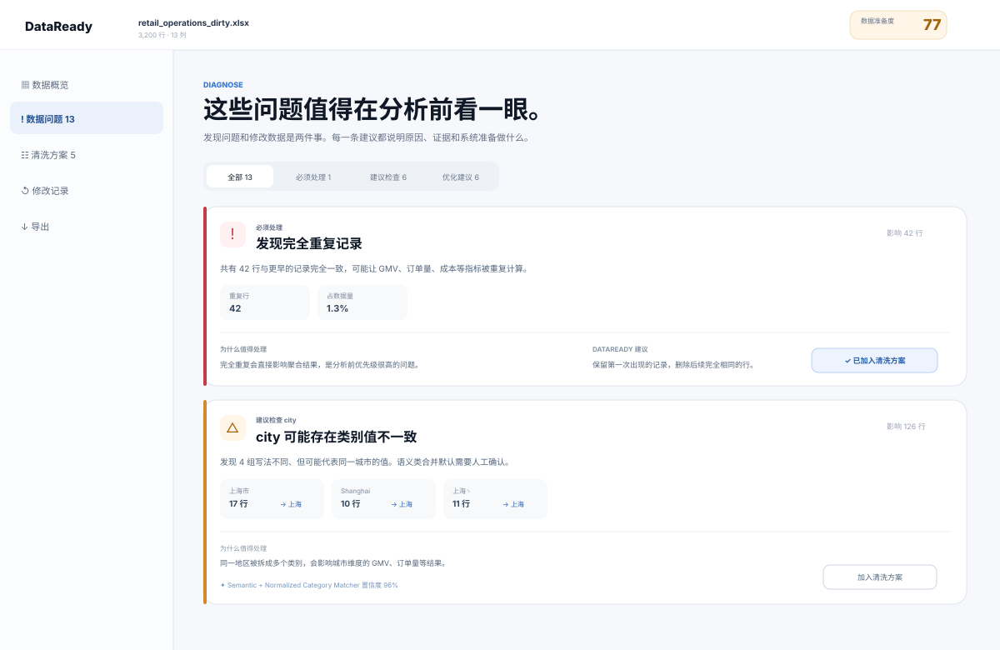
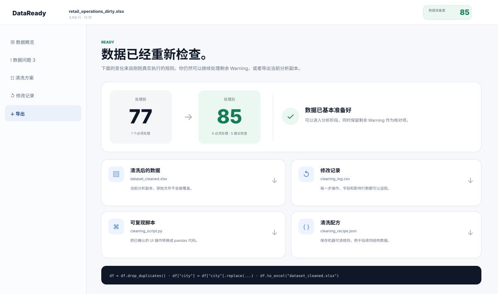

<div align="center">
  

# DataReady

**在分析之前，先确认你的数据是否已经准备好。**

一款面向商业分析场景的本地优先（Local-first）数据体检与安全清洗工具：在浏览器本地完成发现、解释与处理，原始数据不出本机。

[快速开始](#快速开始) · [产品说明](docs/PRODUCT.md) · [架构说明](docs/ARCHITECTURE.md) · [检测规则](docs/DETECTION_RULES.md)

<p>
  
  
  
  
</p>
</div>



## 要解决的问题

很多分析工具都默认数据是干净的，但真实工作里，拿到一份 Excel 之后，往往要先回答一串更基础的问题：

- 关键字段有没有缺失？
- 订单有没有重复？
- 数字列里是不是混进了 `N/A`、`-` 或纯文本？
- `上海 / 上海市 / Shanghai` 会不会其实是同一个维度？
- 一个极端值到底是录入错误，还是正常的大额订单？
- 日期和业务逻辑之间有没有明显冲突？
- 清洗之后，到底改了什么？能不能撤销、能不能复现？

DataReady 把这些问题收敛成一条很窄的流程：**先体检，再建议；先预览，再修改。**



它既不是 Excel 的替代品，也不是「上传表格后和 AI 聊天」的数据分析助手，只专注解决分析开始之前的那一个问题：

> **这份数据，现在真的适合开始分析了吗？**

## 30 秒体验

无需 API Key，也不用准备任何文件：在首页直接点击 **「体验示例经营数据」** 即可跑通完整流程。

内置 Demo 是一份虚构的零售经营数据，共 **3,200 行 × 13 列**，主动加入了真实商业分析中常见的数据问题：完全重复、城市命名混乱、日期格式不一致、缺失编码、数值文本、极端 GMV、负值、逻辑异常等。



进入工作台后，DataReady 会先完成 Dataset Understanding，再统一给出问题清单，而不是让用户自己在表格里逐列排查。

## 数据体检

v0.1 聚焦 8 类检查：

| 检查 | 典型问题 | DataReady 的处理原则 |
| --- | --- | --- |
| 缺失值 | 空值、`N/A`、`-` | 识别，不擅自填充 |
| 完全重复 | 整行重复 | 低风险，可默认加入清洗方案 |
| 类型异常 | 数字列混入文本 | 明确可转换时建议修复 |
| 类别不一致 | `上海 / 上海市 / Shanghai` | 智能匹配，语义合并需确认 |
| 异常值 | GMV 极端值 | 只提示检查，不默认删除 |
| 日期 / 时间 | 混合格式、非法日期 | 安全格式化可建议执行 |
| 常量 / 高唯一值 | 常量字段、疑似 ID | 解释风险，不强制删除 |
| 基础业务逻辑 | `orders = 0` 但 `gmv > 0` | 标为可能异常，交由用户判断 |



每张 Issue Card 只回答几个真正有用的问题：**哪里有问题、为什么值得检查、影响多少数据、建议怎么处理、这一步的风险有多高。**

## Cleaning Plan：系统提方案，用户做决定

DataReady 没有「一键 AI 洗干净」的按钮。

所有操作都会先进入 Cleaning Plan，并按风险分级处理：

- **低风险**：删除完全重复、清理明确的空值编码、可靠的类型转换等，可以默认选中；
- **中风险**：类别语义合并、缺失值填充、删除常量字段等，默认等待用户确认；
- **高风险**：删除异常值、Winsorize、修改业务数值等，绝不默认执行。

执行前会统一展示 Preview，包括受影响字段、Before / After 与预计影响行数；原始数据始终保留。

## 清洗后重新检查

清洗不是终点。执行 Cleaning Plan 之后，DataReady 会重新跑一次体检，让用户直接看到处理前后的变化。



Data Readiness 只是辅助入口，不是假装绝对科学的数据质量认证。它从完整性、有效性、一致性、唯一性和逻辑合理性五个维度，帮助用户快速比较 **Before / After**；真正的判断依据仍然是具体 Issues。


## 可追踪、可撤销、可复现

最终交付的不只是一份新的 Excel。DataReady 可以导出：

- `*_cleaned.xlsx`：清洗后的数据；
- `cleaning_log.csv`：每一步改了什么；
- `cleaning_script.py`：与 UI 操作一一对应的 pandas 脚本；
- `cleaning_recipe.json`：机器可读的清洗配方，可用于相似数据。

Python Script 不是让模型「事后猜一段差不多的代码」，而是由确定性的 Cleaning Action 模板生成，因此 UI 操作与脚本可以逐条对应。

示例输出见 [`examples/`](examples/)。

## 为什么 v0.1 不强依赖 AI

DataReady 把确定性问题与语义问题分开处理：

```text
原始数据
   │
   ├── 规则 / 统计引擎
   │      ├── Missing
   │      ├── Duplicate
   │      ├── Type
   │      ├── IQR
   │      └── Date / Logic
   │
   └── Semantic Provider
          ├── v0.1：本地规范化 / alias / 模糊匹配
          └── Future：可选 AI Provider
```

v0.1 没有 API Key 也能完整使用，公开静态页面也不会要求用户把模型密钥填进浏览器。未来若增加 AI Provider，它只负责更模糊的语义判断与解释，既不接管确定性计算，也不能绕过 Preview 直接修改数据。

## 隐私设计

核心的解析、体检、清洗与导出全部在浏览器本地完成：

- 不需要登录；
- 不需要后端数据库；
- 不上传完整原始数据；
- 刷新页面后不会把数据悄悄同步到云端；
- 原始文件永远不会被覆盖。

未来若接入模型能力，默认也只应传递必要的结构化摘要，而不是整份原始数据。

## 快速开始

要求：**Node.js 20+**。

```bash
git clone https://github.com/Henry369-0/dataready.git
cd dataready
npm install
npm run dev
```

然后打开 Vite 提示的本地地址即可。

生产构建：

```bash
npm run build
npm run preview
```

类型检查 + 构建：

```bash
npm run check
```

## GitHub Pages

仓库已包含 `.github/workflows/pages.yml`。上传仓库后，在 GitHub 的 **Settings → Pages** 中将 Source 设为 **GitHub Actions**，此后每次 `main` 分支更新都会自动构建并发布静态站点。

Vite 使用相对 `base`，仓库挂在 GitHub Pages 子路径下也能正常工作，无需把用户名或仓库名硬编码进源码。

## 目录结构

```text
dataready/
├── src/
│   ├── engine/                 # profiling / detection / cleaning / scoring / export
│   ├── App.tsx                 # 产品流程与工作台
│   ├── styles.css              # 视觉系统
│   └── types.ts                # 核心数据结构
├── public/
│   ├── demo/                   # 一键体验数据
│   └── logo-mark.svg
├── examples/                   # Excel Demo + 示例输出
├── docs/
│   ├── assets/                 # README 图文素材
│   ├── PRODUCT.md
│   ├── ARCHITECTURE.md
│   └── DETECTION_RULES.md
├── .github/workflows/          # Quality Check + GitHub Pages
├── CONTRIBUTING.md
├── SECURITY.md
└── LICENSE
```

## 验证改动

运行 `npm ci`、`npm test` 与 `npm run check`。回归测试覆盖原值保留、错误 CSV、合法日期及清洗行为；CI 还会执行导出的 Python，与界面清洗结果比较。

本地执行 Python 回放需先安装 `pandas openpyxl xlsxwriter`，并把 `DATAREADY_PYTHON` 设为 Python 可执行文件（例如 `python`）。未设置时会明确跳过 Python 回放用例。CSV 导入保留文本原值，数值转换在清洗方案中确认；生成脚本的 `input_path` 可改为实际 Excel 或 CSV 路径。

## 技术栈

- React + TypeScript + Vite
- SheetJS：浏览器端 Excel 读写
- Papa Parse：CSV 解析
- Lucide：克制的界面图标
- 规则引擎：Profiling / Detection / Scoring / Cleaning
- Local-first：核心链路不依赖服务端

## v0.1 明确不做

为了让第一版真正完整，当前不包含：

- BI Dashboard；
- Chat with Data；
- 自动商业洞察；
- 登录 / 云同步；
- 数据库 Connector；
- 多文件 Join；
- SPSS / 回归 / 因子分析；
- AI Agent；
- 自动删除异常值；
- 「一键把数据改正确」这类不可解释的操作。

这些功能看起来更大，但会稀释 DataReady 最核心的问题：**分析之前，这份数据是否已经准备好？**

## 后续方向

如果 v0.1 的核心体验被证明有用，再考虑：

- 更强的 Semantic Provider；
- 自定义数据规则；
- Recipe 复用与结构匹配；
- 多期经营数据完整性检查；
- Data Dictionary；
- Academic / Questionnaire Mode。

## 参与贡献

Bug、检测规则建议与 UX 改进都欢迎通过 Issue 提交，详见 [CONTRIBUTING.md](CONTRIBUTING.md)。

最有价值的贡献不是再多塞一个功能，而是让 DataReady **更可靠地发现问题、更清楚地解释风险、更安全地完成修改。**

## License

MIT © 2026 DataReady contributors.
